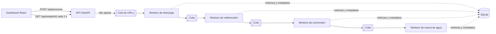

# PMIC · Plataforma de Procesamiento Masivo de Imágenes Concurrente

Procesa lotes de imágenes a partir de sus URLs: las **descarga**, las **redimensiona**, las **convierte a PNG** y les aplica una **marca de agua**, todo de forma concurrente. Cada etapa tiene sus propios workers y registra tiempos, errores y metadatos, para saber exactamente dónde se gasta el tiempo y qué falló.

> Proyecto académico de Ingeniería de Sistemas · Corporación Universitaria del Caribe (CECAR).


## El problema

Procesar decenas de imágenes una por una es lento, y cuando algo falla a mitad del lote no queda claro en qué paso ni con qué archivo.

## La solución

Un pipeline **productor-consumidor** de cuatro etapas conectadas por colas. Mientras una imagen se redimensiona, otra ya se está descargando y una tercera se está convirtiendo. La API lanza el pipeline en un hilo aparte y responde de inmediato con un identificador de proceso; el dashboard consulta el avance cada 2 segundos.



## Funcionalidades

- Hasta **50 URLs** por proceso, con validación de entrada mediante Pydantic.
- Entre **1 y 10 workers** configurables por etapa.
- Estado del proceso: `EN_PROCESO`, `COMPLETADO`, `COMPLETADO_CON_ERRORES` o `FALLIDO`. Si una imagen falla, el resto del lote continúa.
- Métricas por etapa: imágenes procesadas, fallidas, tiempo total y tiempo promedio.
- Metadatos de cada imagen (qué worker la procesó, cuándo y cuánto tardó) guardados en SQLite con acceso thread-safe.
- Dashboard en React para lanzar procesos y seguir su avance en tiempo real.

## Tecnologías

| Capa | Tecnología |
| --- | --- |
| Backend | Python 3.10+, FastAPI, Pydantic, Uvicorn |
| Procesamiento | Pillow, Requests, `threading` y `queue` |
| Persistencia | SQLite |
| Frontend | React, Vite, Tailwind CSS, Axios |

## Estructura

```
PMIC/
├── backend/
│   ├── main.py          # API REST y validación de entrada
│   ├── pipeline.py      # Orquesta las 4 etapas y sus colas
│   ├── downloader.py    # Etapa 1: descarga
│   ├── resizer.py       # Etapa 2: redimensión a 800 px de ancho
│   ├── converter.py     # Etapa 3: conversión a PNG
│   ├── watermark.py     # Etapa 4: marca de agua
│   ├── models.py        # Estados del proceso y métricas por etapa
│   ├── database.py      # Persistencia SQLite thread-safe
│   └── requirements.txt
└── frontend/            # Dashboard React + Vite
```

## Cómo ejecutarlo

Requisitos: Python 3.10 o superior y Node.js 18 o superior.

**1. Backend** (en una terminal):

```bash
cd backend
pip install -r requirements.txt
uvicorn main:app --reload --port 8000
```

La API queda en http://localhost:8000 y su documentación interactiva en http://localhost:8000/docs.

**2. Frontend** (en otra terminal):

```bash
cd frontend
npm install
npm run dev
```

Abre http://localhost:5173, pega una URL de imagen por línea, ajusta los workers y pulsa iniciar.

Las imágenes procesadas se guardan en `backend/storage/`.

## API

| Método | Ruta | Descripción |
| --- | --- | --- |
| POST | `/api/procesar` | Inicia un proceso. Cuerpo: `{"urls": [...], "workers": {"descarga": 2, "redimensionamiento": 2, "conversion": 2, "marca_agua": 2}}` |
| GET | `/api/estado/{proceso_id}` | Estado, métricas por etapa y resumen del proceso |
| GET | `/api/db/{proceso_id}` | Metadatos guardados en SQLite para cada imagen |
| GET | `/` | Estado del servicio |

Ejemplo de respuesta de `/api/estado/{proceso_id}` con 4 URLs, una de ellas inexistente:

```json
{
  "estado": "COMPLETADO_CON_ERRORES",
  "tiempo_total_ejecucion": 5.267,
  "metricas_etapas": {
    "descarga":           { "total_procesados": 3, "total_fallidos": 1, "tiempo_promedio": 0.011 },
    "redimensionamiento": { "total_procesados": 3, "total_fallidos": 0, "tiempo_promedio": 0.089 },
    "conversion":         { "total_procesados": 3, "total_fallidos": 0, "tiempo_promedio": 0.027 },
    "marca_agua":         { "total_procesados": 3, "total_fallidos": 0, "tiempo_promedio": 0.018 }
  },
  "resumen": { "total_imagenes": 4, "total_fallidos": 1, "porcentaje_exito": 75.0 }
}
```

## Autor

**Daniel Diaz Montiel** · [LinkedIn](https://www.linkedin.com/in/daniel-diaz-225855294) · [GitHub](https://github.com/DanielDiaz2805)
